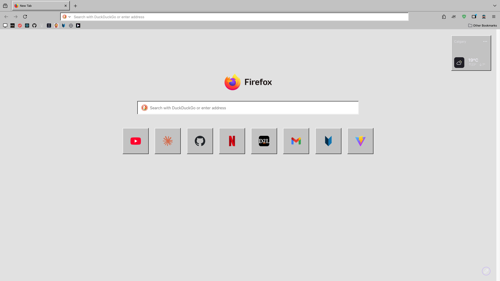

# retro-firefox

### Designed to replicate the look of Windows95

adapted from [osem598's Repo](https://github.com/osem598/Firefox-98)
## Developing

Run `./dev.sh` to open a separate Firefox test window that loads the theme directly from this repo's `chrome/` folder. It runs alongside your normal Firefox and doesn't touch it.

- **Live editing:** in the test window press `Cmd+Opt+Shift+I` to open the Browser Toolbox, go to the **Style Editor**, and pick `userChrome.css`. Changes apply instantly, and `Cmd+S` saves them straight into the repo file.
- **Editing in your own editor:** quit the test window (`Cmd+Q`) and run `./dev.sh` again to see your changes. Changes to `userContent.css` (the new tab page) also show up after restarting the test window.
